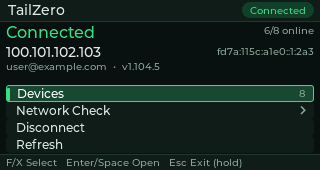
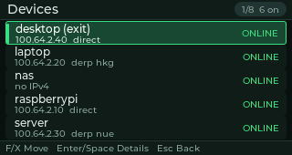
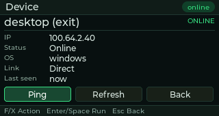
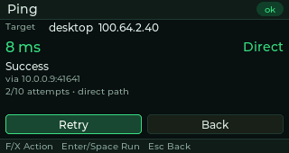

# TailZero

TailZero is a native Tailscale manager for the **Cardputer Zero**: a 320×170 LVGL
application that shows the state of the local `tailscaled` daemon, lists the
devices in your tailnet, pings peers, runs `tailscale netcheck`, and brings the
connection up or down — all from the built-in keyboard.

TailZero does **not** implement a VPN protocol and does **not** install or modify
Tailscale. It talks to the `tailscale` command line tool of an existing
installation and runs as a normal user: it never asks for a root password and
never stops the `tailscaled` service.

- Platform: Cardputer Zero (Raspberry Pi CM0), Debian 13 *trixie* arm64, APPLaunch launcher
- Display: 320×170 ST7789V framebuffer (Linux fbdev), physical keyboard via evdev
- Package: `tailzero_0.1.0-1_arm64.deb` (Debian package name `tailzero`)
- License: MIT

## Screenshots

| Home | Devices |
| --- | --- |
|  |  |
| **Device details** | **Ping** |
|  |  |

## Features

The UI is a small stack of pages, driven entirely by the keyboard:

- **Home** — connection state (`Connected` / `Disconnected` / `Needs login` /
  `Starting` / `tailscaled down`), Tailscale IPv4 with the IPv6 address on the
  same line, the tailnet name and Tailscale version (`name · vX.Y.Z`), the
  online/total peer count, and a menu with *Devices*, *Network check*,
  *Connect/Disconnect* and *Refresh*.
- **Devices** — scrollable tailnet peer list showing name, Tailscale IPv4,
  online/offline state and the current path (`DIRECT` or `DERP` relay). The
  list is sorted online-first and never depends on the JSON peer order.
- **Device details** — selected peer's host name, IPv4/IPv6 addresses, OS,
  online state, link type, DERP relay code and last-seen time, with actions
  *Ping*, *Refresh* and *Back*.
- **Ping** — runs `tailscale ping <device-ip>` in the background with the CLI
  semantics: one ping per second, at most 10 attempts, stopping early as soon as
  a direct path is established. The page shows the attempt counter, the latest
  latency and the route (direct address, DERP region or peer relay), supports
  cancel, and distinguishes success, timeout, offline peer and command errors.
- **Network check** — runs `tailscale netcheck` (JSON when available, text
  fallback) and summarizes UDP availability, IPv4/IPv6 connectivity, NAT port
  mapping, hair-pinning and the preferred DERP region with its latency.

State refreshes immediately at startup, then every 5 seconds (configurable), and
again right after connect/disconnect/ping/netcheck. All command execution happens
on one worker thread, so rendering never blocks; a failed command produces a
short readable error instead of a crash. Errors covered include: `tailscale` not
installed, `tailscaled` not running, not logged in, disconnected interface,
missing operator privileges, empty tailnet, offline peer, ping timeout, malformed
JSON, and the daemon restarting while the app is open.

## Keyboard controls

| Key | Action |
| --- | --- |
| `F` / `X` (or `Up` / `Down`) | Move the selection (lists scroll to keep it visible) |
| `Z` / `C` (or `Left` / `Right`) | Secondary action / horizontal movement where offered |
| `Enter` / `Space` | Activate the selected menu item or button (both keys confirm) |
| `Esc` | Back: leave the current page, return to Home, or close a dialog |
| `Esc` (hold ~0.7 s) | Exit TailZero cleanly (works on every page) |
| `1` … `5` | Jump directly to Home, Devices, Device details, Ping, Network check |

Both `Enter` (the OK key) and the space bar confirm the current selection, so
either hand position works. The plain letter keys `F` / `X` / `Z` / `C` work as arrow keys without the
`Fn` modifier: the Cardputer Zero prints its arrow shortcuts on those keys, and
TailZero never needs text input, so the letters are mapped to directions. Holding
an arrow key for ~0.4 s starts auto-repeat (one step every 90 ms), which is how
long pages such as **Network check** keep scrolling; a single tap still moves one
step.

A short `Esc` never exits the app; on the Home page it shows the hint
"Hold Esc to quit". This follows the Cardputer Zero launcher contract, which may
send `SIGINT` on a long Home press and expects the app to exit by itself.

## Install

The application is distributed as a Debian package and registered with
APPLaunch. Installing requires root once (normal for a `.deb`); the application
itself runs as your desktop user.

```bash
sudo dpkg -i tailzero_0.1.0-1_arm64.deb
systemctl --user restart APPLaunch.service      # pick up the new launcher entry
```

Then open **APPLaunch → TailZero**. Package layout:

| Path | Content |
| --- | --- |
| `/usr/bin/tailzero` | Application binary (0755) |
| `/usr/share/APPLaunch/applications/tailzero.desktop` | APPLaunch launcher entry |
| `/usr/share/APPLaunch/share/images/tailzero*.png` | Launcher icon (256/100/80 px) |
| `/usr/share/tailzero/images/` | Runtime assets (icons) |
| `/usr/share/doc/tailzero/` | README, LICENSE, copyright |

Uninstall with `sudo dpkg -r tailzero` (user settings in
`~/.config/TailZero/` are left in place).

Read-only operations (`status`, `ip`, `ping`, `netcheck`) work immediately. For
**Connect / Disconnect** the device owner must run a one-time Tailscale operator
step; until then TailZero shows a hint instead of failing. See
[docs/OPERATOR.md](docs/OPERATOR.md), [docs/DEPLOY.md](docs/DEPLOY.md) and
[docs/TESTING.md](docs/TESTING.md).

## Build

TailZero is built **natively on the Cardputer Zero** against a prebuilt LVGL 9.5
static library. The official Cardputer Zero cross-build path is documented at the
end of this section for Debian hosts and CI.

### On-device native build (the path used here)

Prerequisites on the device: `cmake` ≥ 3.25, `ninja-build`, `g++`, `python3`,
and an LVGL 9.5 source tree (the helper scripts default to
`~/tzdev/deps/lvgl-9.5.0`).

```bash
# 1. Build LVGL once into ~/tzdev/sysroot (cached, keyed on src/config/lv_conf.h)
bash tools/device/build-lvgl.sh src/config/lv_conf.h

# 2. Configure + build TailZero against that prefix
bash tools/device/build-app.sh "$PWD" "$HOME/tzdev/sysroot" 2
#    -> build/tailzero
#    equivalent manual cmake:
#    cmake -S . -B build -G Ninja -DCMAKE_BUILD_TYPE=Release \
#          -DTAILZERO_LVGL_PREFIX="$HOME/tzdev/sysroot"
#    cmake --build build -j2
```

From a Windows host the helper `tools/dev.ps1` syncs the repository over SSH and
runs the same steps (`pwsh tools/dev.ps1 build -Slot <name>`); see
[docs/TESTING.md](docs/TESTING.md) for the run/screenshot loop. The helper reads
the device address from the environment only — export `TAILZERO_HOST`,
`TAILZERO_USER`, `TAILZERO_PASS` and optionally `TAILZERO_HOSTKEY` (SSH host key
fingerprint) before using it. No host address or credential is stored in the
repository.

Build options (`CMakeLists.txt`):

| Option | Default | Description |
| --- | --- | --- |
| `TAILZERO_LVGL_PREFIX` | empty | Use prebuilt LVGL from this prefix (`lib/liblvgl.a`, `include/lvgl`) |
| `TAILZERO_LVGL_SOURCE_DIR` | empty | Build LVGL from a local source tree instead of fetching it |
| `APP_NAME` | `tailzero` | Executable name |
| `APP_FRAMEBUFFER_DEVICE` | `/dev/fb0` | Fallback framebuffer (auto-detects the panel from `/proc/fb`) |
| `APP_KEY_INPUT_DEVICE` | empty | evdev keypad path; empty = auto-detect the tca8418 keyboard |
| `TAILZERO_BUILD_TESTS` | `OFF` | Also configure the host test suite |

### Building the .deb

```bash
bash tools/device/package.sh        # -> build/deb/tailzero_0.1.0-1_arm64.deb
bash tools/device/install-deb.sh    # dpkg -i + APPLaunch restart (device tooling)
```

`package.sh` stages the layout above, writes the Debian control data and calls
`dpkg-deb`. It requires `build/tailzero` to be an ARM64 binary and refuses to
package anything else. `install-deb.sh` is developer tooling only; the shipped
application never runs `dpkg` or `sudo`.

### Official cp0-cross path (Debian host / CI)

The official Cardputer Zero Template builds the aarch64 package from a Debian
host with the `crossbuild-essential-arm64` toolchain and the CMake presets
`cp0-cross` / `cp0-cross-rel` / `cp0-cross-deb` (or the one-shot workflow
`cmake --workflow --preset cp0-cross-package`), producing
`dist/<AppName>_<version>_<revision>_arm64.deb` via CPack. This repository
currently builds natively on the device and packages with
`tools/device/package.sh`, so the Template's `CMakePresets.json`, cross toolchain
file and `cmake/cm0-package.cmake` are **not** part of this tree. To use the
cp0-cross path, start from the CardputerZero Template and add this project's
sources and store metadata (`app-builder.json`); the AppBuilder CI uses the same
approach.

## Configuration and mock mode

TailZero keeps only a few per-user settings in
`$XDG_CONFIG_HOME/TailZero/config.ini` (default `~/.config/TailZero/config.ini`).
The file is optional; missing keys keep their defaults. There is no `/etc`
configuration.

```ini
# TailZero configuration
refresh_interval_sec=5     # background status refresh, clamped to 1..300
auto_refresh=true          # false = only manual Refresh
ping_timeout_ms=12000      # tailscale ping budget
netcheck_timeout_ms=25000  # tailscale netcheck budget
initial_page=              # dev/screenshot helper: home|devices|details|ping|netcheck
```

Environment variables (development and screenshots, all optional):

| Variable | Description |
| --- | --- |
| `TAILZERO_MOCK_DIR` | Replay canned fixture files instead of running the `tailscale` CLI; ready-made scenarios live in `tests/fixtures/` (see its README for the file convention) |
| `TAILZERO_DEMO` | Force the start page: `home`, `devices`, `details`, `ping`, `netcheck` |
| `TAILZERO_DEMO_STATE` | Preview-harness scenario: `connected`, `disconnected`, `derp`, `offline`, `login`, `empty`, `error`, `noinstall` |
| `TAILZERO_FBDEV` | Framebuffer device override; the app also honors `APPLAUNCH_LINUX_FBDEV_DEVICE` (launcher-provided) and `LV_LINUX_FBDEV_DEVICE`, and otherwise auto-detects the ST7789V panel from `/proc/fb` |
| `TAILZERO_KEYDEV` | evdev keypad override (default: auto-detect the tca8418 keyboard) |

## Architecture

```text
src/
├── main.cpp              entry point: LVGL + panel + keyboard + render loop
├── app/
│   ├── app_service.*     one worker thread: status refresh, up/down, ping, netcheck
│   ├── app_state.*       immutable AppState snapshot shared with the UI
│   ├── app_config.*      ~/.config/TailZero/config.ini
│   ├── backend_factory.* real CLI backend selection
│   ├── display.*         fbdev bootstrap, panel auto-detection
│   └── screen_manager.*  page routing and refresh tick
├── tailscale/
│   ├── command_runner.*  fork+execv argv execution, timeouts, output caps, no zombies
│   ├── tailscale_client.* typed wrapper over the tailscale CLI
│   ├── status_parser.*   tolerant JSON parsers (status, netcheck, ping)
│   ├── json_lite.*       minimal JSON reader used by the parsers
│   ├── mock_backend.*    TAILZERO_MOCK_DIR fixture replay for tests/screenshots
│   ├── backend.h         backend interface shared by the CLI and mock backends
│   └── models.*          BackendState / PeerInfo / StatusSnapshot / NetcheckReport
├── input/keypad.*        tca8418 evdev -> LVGL key events + long-press detection
├── ui/
│   ├── theme.*           dark palette and 320×170 layout tokens
│   ├── screen.h          Screen contract (build/refresh/handle_key)
│   ├── format.*          compact value/error formatting helpers
│   ├── widgets/          title bar, status chip, hint bar, list row, button bar, toast, spinner
│   └── screens/          Home, Devices, Details, Ping, Netcheck (+ shared BasePage)
└── preview/              tailzero-ui-preview: real screens, synthetic data, no backend
```

Key design points:

- **No shell, no string concatenation**: every command is an `argv` vector passed
  to `fork` + `execv`; the `tailscale` binary comes from a fixed candidate list,
  and IP addresses are validated before use.
- **Never blocks the UI**: `AppService` owns exactly one worker thread; the UI
  timer reads an immutable `AppState` copy and only enqueues jobs.
- **Bounded resources**: command timeouts, capped stdout/stderr buffers, one
  child at a time, no zombie processes.
- **Tolerant parsing**: unknown JSON fields are ignored, missing fields fall back
  to defaults, malformed input yields an explicit error.
- **Static LVGL**: `liblvgl.a` is linked in, so the `.deb` has no LVGL runtime
  dependency (only `libc6`, `libstdc++6`).

## Testing

Unit tests (parsers, models, command runner) run on the device with plain g++:

```bash
bash tools/device/run-tests.sh       # or: pwsh tools/dev.ps1 test
```

The UI can be exercised without Tailscale through the mock backend
(`TAILZERO_MOCK_DIR`, scenarios under `tests/fixtures/`) or the
`tailzero-ui-preview` harness. The full test matrix (mock states, error cases,
real-device checklist and store screenshot capture) is described in
[docs/TESTING.md](docs/TESTING.md).

### Verified on the Cardputer Zero (0.1.0)

Measured on the reference device (Debian 13 trixie aarch64, g++ 14.2,
cmake 3.31.6, LVGL 9.5.0 linked statically, Tailscale 1.104.5):

- Build clean with zero warnings in `src/ui` and `src/preview`;
  `build/tailzero` is 1,189,624 bytes.
- **83/83** unit tests pass (`pwsh tools/dev.ps1 test`).
- Real tailnet: 12 peers / 6 online, direct ping 8–61 ms, netcheck UDP + IPv4 +
  IPv6 OK, UPnP/NAT-PMP/PCP mapping, preferred DERP `hkg`; `tailscale down`/`up`
  as operator switch the app between Disconnected and Connected.
- Runtime cost: startup-to-ready **167 ms**, **1.5 %** CPU while idle with the
  5 s refresh, **4.4 MB** VmRSS, 2 threads, 6 open fds.
- Package installed on the device as `tailzero 0.1.0-1` (arm64); APPLaunch shows
  the TailZero entry with its icon, and the physical-key flow (Up/Down, Enter,
  Esc, long-Esc exit) passes end-to-end.

## Known limitations

- Tailscale must already be installed and running; TailZero never installs,
  upgrades or uninstalls it and never stops `tailscaled`.
- Connect/Disconnect need the one-time `tailscale set --operator` deployment
  step. Without it the app explains the missing permission instead of escalating
  privileges.
- Login authorization is shown as a URL on screen; TailZero does not launch a
  browser (the launcher contract forbids it and there is no browser on the panel).
- The UI is English-only; the store listing itself is localized (en / zh-CN / ja).
- Data that Tailscale does not expose (for example the tailnet name in old
  versions, or a DERP region when a direct path exists) is omitted rather than
  guessed.
- Only the arm64 Debian package for the Cardputer Zero is built and supported.
- The `store.author.github` and `store.source_repo` values in `app-builder.json`
  are placeholders until the public source repository exists.

## License

MIT — see [LICENSE](LICENSE).
